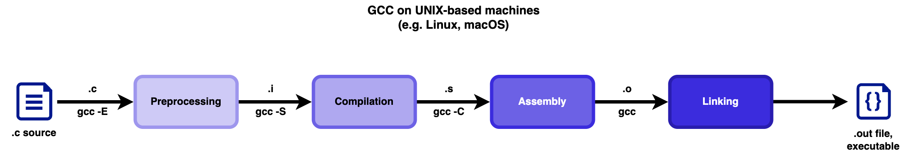

# Infrastructure cheatsheet

The exercises in this section use standard input for data. The return value of `main` is the program's exit code; `0` conventionally means success.

## GCC

### Preprocessor

The preprocessor runs before compilation. It expands `#include`, replaces `#define` names, and selects code between conditional directives:

```c
#include <stdio.h>

#define GROUP "314CD"
#define SQUARE(x) ((x) * (x))

#ifdef GROUP
#define HELLO printf(GROUP "\n")
#endif
```

It copies text; it does not evaluate expressions or understand C types. Without parentheses, `SQUARE(1 + 2)` could expand to `1 + 2 * 1 + 2`, which is `5`, not `9`. Macro arguments are substituted each time, so avoid expressions with side effects such as `SQUARE(i++)`.

### Compilation stages



The preprocessor runs first. It handles directives such as `#include` and `#define`, and can produce an expanded source file:

```sh
gcc -E main.c -o main.i
```

The compiler translates the preprocessed C source into assembly:

```sh
gcc -S main.i -o main.s
```

The assembler translates assembly into an object file:

```sh
gcc -Wall -Wextra -c main.c -o main.o
```

The linker combines object files and libraries into an executable:

```sh
gcc main.o -o main
```

Useful flags include `-Wall` and `-Wextra` for warnings, `-g` for debugging information, `-O0` and `-O2` for optimization levels, `-I` for header directories, `-L` for library directories, and `-o` for the output name. Put libraries such as `-lm` after the source or object files that use them. `-o` overwrites an existing output file.

## Make

```make
CC = gcc
CFLAGS = -Wall -Wextra

main: main.c
	$(CC) $(CFLAGS) main.c -o main

run: main
	./main

clean:
	rm -f main

.PHONY: run clean
```

The first target is the default. A target is rebuilt when a dependency is newer than it. Commands must begin with a TAB. `.PHONY` marks names that are actions rather than files. If there is no Makefile but `main.c` exists, `make main` can use Make's built-in rule and run a command similar to `cc main.c -o main` (without this exercise's `-Wall -Wextra` flags). If neither a Makefile nor a suitable source file exists, Make reports that it has no rule to build `main`.
